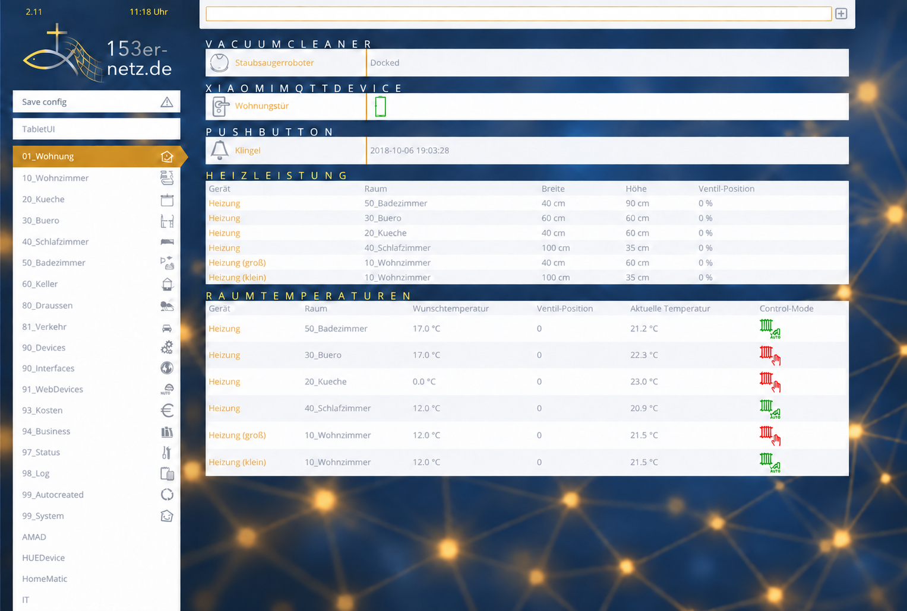

# FHEM Style – 153er-netz.de Edition

Eigenständig installierbare Edition des FHEM-Styles von [Matthias Kleine (Kleinor)](https://github.com/klein0r/fhem-style-haus-automatisierung), basierend auf Version 2.19. Layout, Abstände, Größen und Bedienfunktionen bleiben unverändert. Geändert sind Theme-Namespace, Logo, Hintergrund und die primäre Akzentfarbe.



> Das derzeit enthaltene Fisch-Kreuz-Netz-Logo ist ein freigegebener Konzeptentwurf. Es wird durch das offizielle Original ersetzt, sobald dieses als freigestellte Quelldatei vorliegt.

## Installation per Copy & Paste

```text
update add https://raw.githubusercontent.com/parussel/fhem-style-153er-netz/main/controls_153er_netz_theme.txt
update check 153er_netz_theme
update all 153er_netz_theme
```

Danach unter **Select Style** den Style `153er_netz` auswählen und die Seite neu laden.

Optionale Einstellungen wie beim Original:

```text
attr WEB JavaScripts codemirror/fhem_codemirror.js
attr WEB codemirrorParam { "theme": "blackboard", "lineNumbers":true, "lineWrapping": true, "height": "auto", "autocomplete": true }
attr WEB roomIcons Save.config:message_attention
```

## Rückwechsel und Deinstallation

Zuerst unter **Select Style** einen anderen Style auswählen. Dann die Updatequelle abmelden:

```text
update delete https://raw.githubusercontent.com/parussel/fhem-style-153er-netz/main/controls_153er_netz_theme.txt
```

Für eine vollständige Dateientfernung anschließend im FHEM-Installationsverzeichnis:

```sh
sudo ./uninstall.sh /opt/fhem
```

Das Skript entfernt ausschließlich Dateien und Verzeichnisse der Edition.

## Hintergrundanimation

Der Hintergrund bewegt sich langsam über einen 52-Sekunden-Zyklus. Menüs, Tabellen und Steuerelemente bewegen sich nicht. Bei `prefers-reduced-motion: reduce` ist die Animation deaktiviert.

## Entwicklung und Prüfung

```powershell
powershell -ExecutionPolicy Bypass -File tests/verify_theme.ps1
```

## Dank

Ein besonderer Dank gilt [Matthias Kleine (Kleinor)](https://github.com/klein0r/fhem-style-haus-automatisierung). Sein FHEM-Style und seine weitere Arbeit rund um FHEM haben meine eigene Hausautomation und dieses Projekt entscheidend vorangebracht. Diese Edition wäre ohne seine sorgfältige Vorarbeit nicht entstanden.

Auch wenn sein heutiger Schwerpunkt bei anderen Bereichen der Haus- und Gebäudeautomation liegt, arbeitet er weiterhin an zahlreichen Smart-Home-Projekten. Vielen Dank für die investierte Zeit, das offen geteilte Wissen und die hervorragende Arbeit.

## Herkunft und Lizenz

Quellcode unter MIT-Lizenz, abgeleitet von [klein0r/fhem-style-haus-automatisierung](https://github.com/klein0r/fhem-style-haus-automatisierung), Version 2.19. Bildquellen stehen in [ASSETS.md](ASSETS.md).
